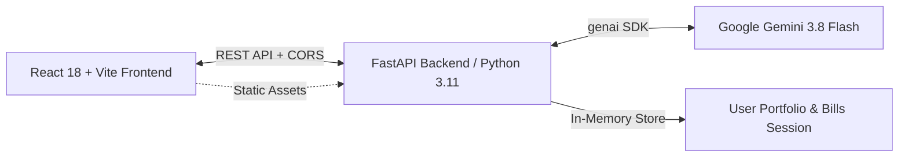

# 🏦 FinSim — AI-Powered Financial Literacy & Banking Simulator

> An interactive, sandbox financial literacy dashboard powered by **FastAPI**, **React 18**, and **Google Gemini 3.8 Flash**. Designed for students and young professionals to master banking, credit scores, smart budgeting, and compounding investments risk-free.

[](https://finsim-916126692403.us-central1.run.app)
[](https://www.python.org/)
[](https://fastapi.tiangolo.com/)
[](https://react.dev/)
[](https://ai.google.dev/)

---

## 🌐 Live Application
* **Production URL:** [https://finsim-916126692403.us-central1.run.app](https://finsim-916126692403.us-central1.run.app)

---

## ✨ Key Features & Modules

### 1. 💎 Dynamic Dashboard & Wealth Tracking
* **Net Worth Growth Visualizer:** Dual-mode chart with **📊 Column Bar Chart** (optimized column widths and spacing) and **📈 Smooth Area Trend** across `7D`, `1M`, and `1Y` horizons in dark emerald green.
* **3D Virtual Card:** Interactive holographic virtual debit card with live flip, card number masking, and toggle freeze security simulation.
* **Financial Health Score Gauge:** Circular SVG donut progress meter evaluating liquidity cushion, debt-to-income load, and multi-asset diversity.
* **Quick Actions:** Instant triggers for money transfers, investments, loan applications, and scenario modeling.

### 2. 🤖 AI Financial Advisor (Google Gemini 3.8 Flash)
* **Live Telemetry Stream:** Injects the user's real-time portfolio balance, active EMIs, and credit score into Gemini's context window with every query.
* **Curated Playbooks & Quick Prompts:** Pre-engineered financial literacy prompts on emergency funds, index funds, debt snowball vs avalanche, and CIBIL protection.
* **Prominent Input Experience:** Inviting golden-accented chat input with automatic suggestions and structured financial tips.

### 3. 📊 Budget & Bills Management
* **50/30/20 Monthly Budget Planner:** Visualizes essential Needs (50%), lifestyle Wants (30%), and compounding Savings (20%) with an SVG donut chart.
* **Interactive Due-Date Calendar:** Monthly calendar with previous/next month navigation, date-specific dues indicators, and payment scheduling.
* **Payment Discipline Simulator:** Settle bills on-time to boost CIBIL credit score (+5 pts) or simulate missed due dates (-45 pts) to witness credit score drops and penalty fees.

### 4. 🛡️ CIBIL Credit Score Simulator
* **Dynamic 300–900 Spectrum Bar:** Segmented bureau gauge (Poor, Fair, Good, Excellent) with live pin tracking.
* **5 Core Credit Health Pillars:** Visual progress meters for Payment History (35%), Credit Utilization (30%), Credit Age (15%), Credit Mix (10%), and Hard Inquiries (10%).
* **Interactive "What-If" Levers:** Test live scenarios:
  * 💳 *Pay ₹15k Balance Early* (+15 pts)
  * ⚠️ *Max Out Card to 85%* (-35 pts)
  * ❌ *Miss Loan EMI (30d)* (-50 pts)
* **Loan Eligibility Matrix:** Pre-approval indicators for Home Loans, Car Loans, and Premium Credit Cards.

### 5. 📈 Investments & Loans Portfolio
* **Asset Allocation:** Positions across Equity Stocks (14–18% p.a.), Mutual Funds SIP (12–15% p.a.), and Bank Fixed Deposits (6.5–7.5% p.a.).
* **Live Financial Market Feed:** Simulated indices for NIFTY 50, SENSEX, USD/INR, and trending market equities.
* **Loan EMI Amortization:** Compare interest rates, tenures, and monthly EMI burdens across Personal, Education, Vehicle, and Home Loans before applying.

### 6. 🎓 FinSim Academy & Reading Room
* **Curated Video Masterclasses:** Embedded educational lessons on compound interest, debt management, stock market fundamentals, and index ETFs.
* **Curated Book Library:** Essential summaries and takeaways from classics (*The Psychology of Money*, *Let's Talk Money*, *The Little Book of Common Sense Investing*, *The Millionaire Next Door*, *Rich Dad Poor Dad*, *The Richest Man in Babylon*).
* **Certification Quiz:** 3-question practical money instincts test with ₹5,000 sandbox cash deposited upon scoring 3/3.

---

## 🛠️ Architecture & Tech Stack



* **Frontend:** React 18, Vite, Custom Modern CSS with per-tab color systems, Responsive SVG Data Visualizations
* **Backend:** FastAPI, Python 3.11, Uvicorn, Pydantic, HTTPX
* **AI Integration:** Google GenAI SDK (`google-genai`), `gemini-3.8-flash`
* **Containerization:** Multi-stage Dockerfile (Node.js 20 build + Python 3.11 slim runtime)
* **Deployment:** Google Cloud Run, Cloud Build, Google Artifact Registry

---

## 🚀 Getting Started Locally

### Prerequisites
* **Node.js** (v18+) & **npm**
* **Python** (v3.10+)
* A **Google Gemini API Key** ([Get one for free at Google AI Studio](https://aistudio.google.com/))

### 1. Clone the Repository
```bash
git clone https://github.com/<your-username>/finsim.git
cd finsim
```

### 2. Configure Environment
Create a `.env` file in the root directory:
```bash
cp .env.example .env
```
Edit `.env` and add your Gemini API key:
```env
GEMINI_API_KEY=your_actual_gemini_api_key_here
```

### 3. Run Backend (FastAPI)
```bash
cd backend
python -m venv venv
# On Windows:
.\venv\Scripts\Activate.ps1
# On macOS/Linux:
source venv/bin/activate

pip install -r requirements.txt
uvicorn main:app --host 0.0.0.0 --port 8080 --reload
```
API Documentation will be available at: [http://localhost:8080/docs](http://localhost:8080/docs)

### 4. Run Frontend (React + Vite)
In a separate terminal:
```bash
cd frontend
npm install
npm run dev
```
Open your browser at: [http://localhost:5173](http://localhost:5173)

---

## ☁️ Deploying to Google Cloud Run

To build and deploy the entire multi-stage container directly to Google Cloud Run:

```powershell
# On Windows PowerShell:
.\deploy.ps1
```
Or via Google Cloud SDK CLI:
```bash
gcloud run deploy finsim \
  --source . \
  --platform managed \
  --region us-central1 \
  --allow-unauthenticated \
  --port 8080 \
  --set-env-vars GEMINI_API_KEY=your_gemini_api_key_here
```

---

## 📄 License
This project is open-source and available under the [MIT License](LICENSE).
